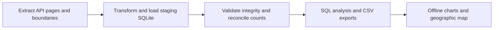

# Pipeline DAG

Every node records elapsed seconds and success/failure in `reports/run.json`. Descendants run only when prerequisites succeed. `src/pipeline.py:DAG` is the executable dependency definition. An extraction failure prevents the load. A checksum or schema failure prevents publishing the staged database. Rebuilds are intentionally complete refreshes to capture source revisions and deletions; this is simpler and more reliable than append-only ingestion for this dataset.

SQLite schema: `crimes` (one row per source ID) and `metadata` (frozen source manifest). Indices cover date, category and community area. Raw inputs form the bronze layer, typed SQLite forms the silver layer, and aggregate reports form the gold layer. No Airflow server is required for this small serial DAG.
